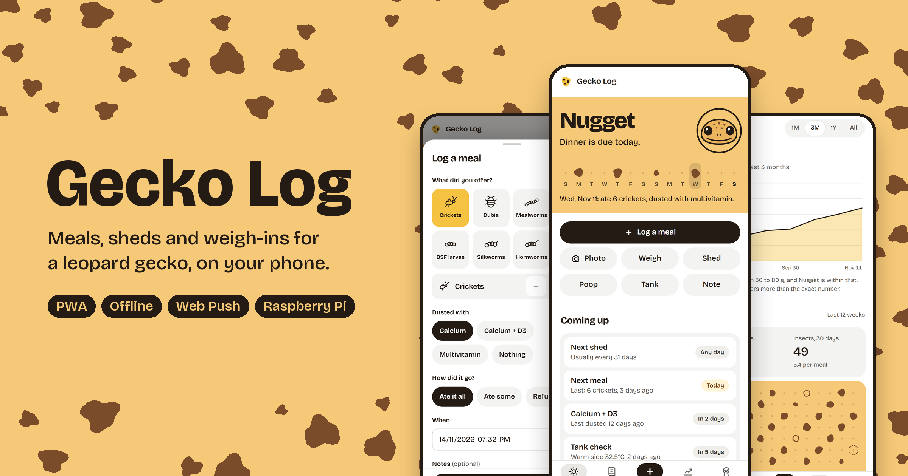
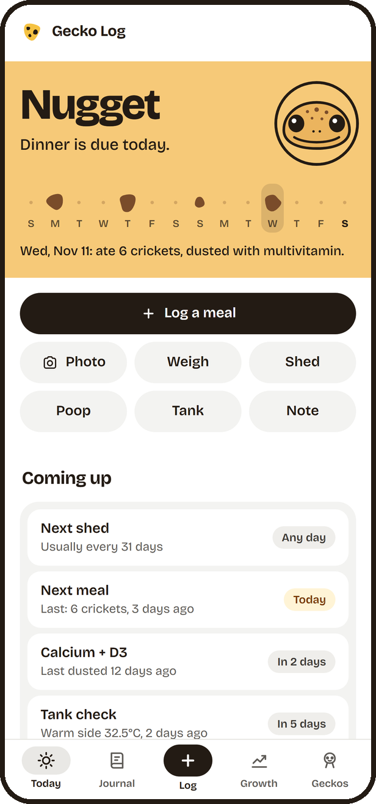
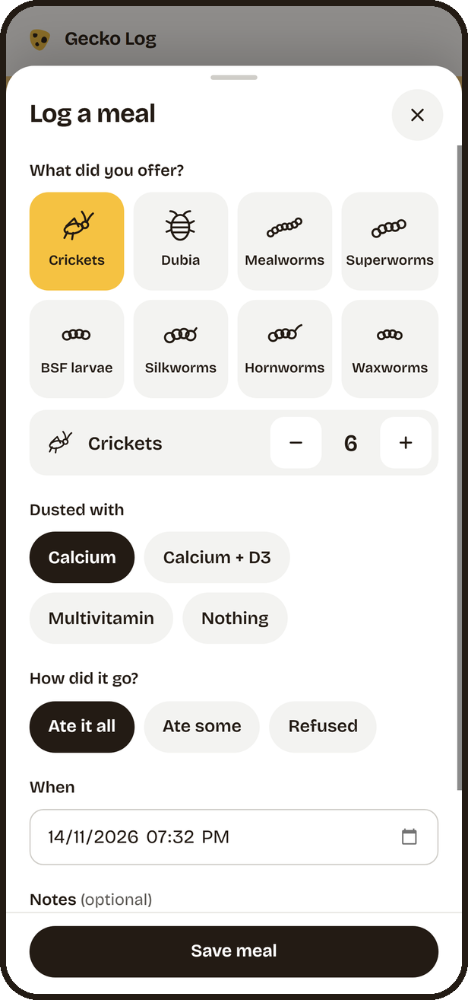
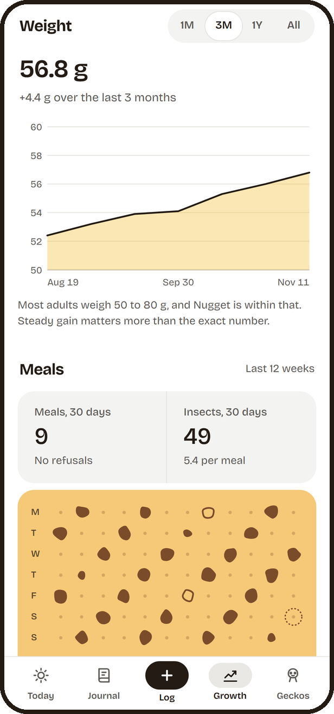
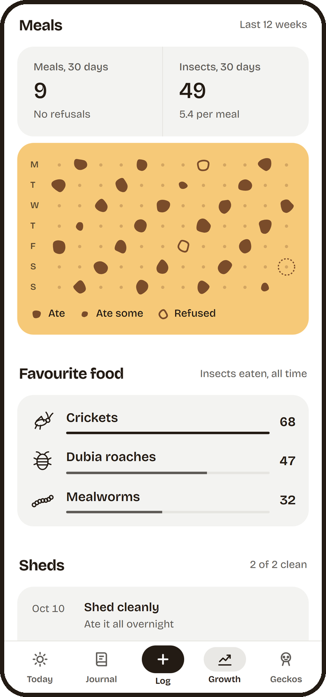
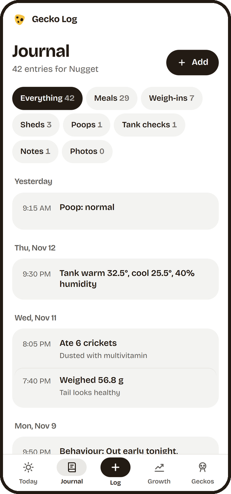
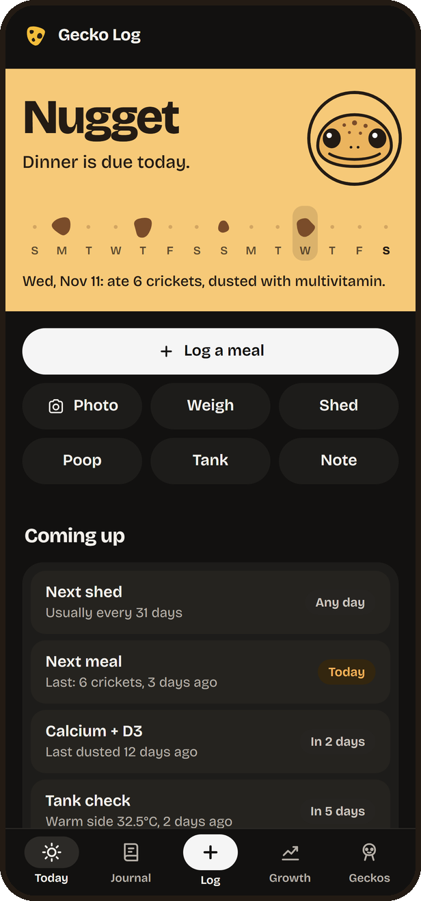
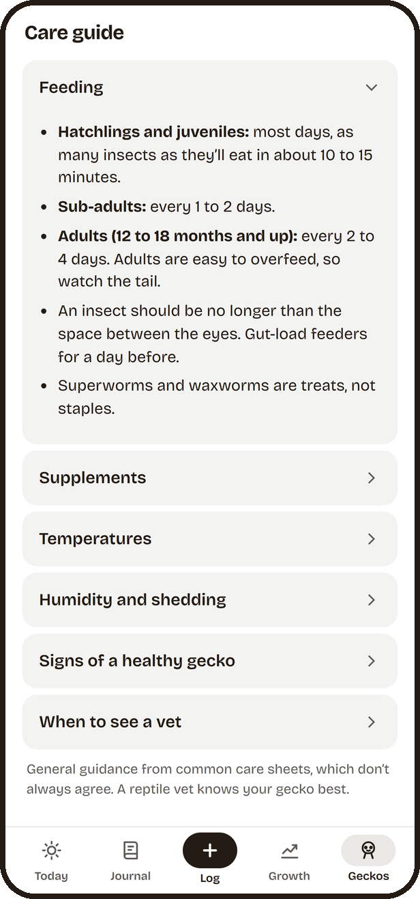
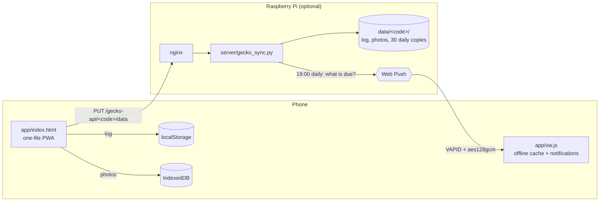

<p align="center">
  
</p>

<p align="center">
  <a href="https://arifaqyl.me/gecko/"></a>
  <a href="https://github.com/arifaqyl/gecko-log/actions/workflows/ci.yml"></a>
  
  <a href="LICENSE"></a>
</p>

**Gecko Log** is a phone app for looking after a leopard gecko: meals and supplements, weigh-ins, sheds, tank temperatures, poop checks, notes and a photo timeline. I built it for Nugget, my Tremper Eclipse.

It is a single HTML file that installs to the home screen and works offline. A small optional Python service on a Raspberry Pi backs the log up and sends a Web Push reminder on the evenings something is due.

**Try it:** open [arifaqyl.me/gecko](https://arifaqyl.me/gecko/) on your phone, then *Add to Home Screen*.

## Screens

<table>
  <tr>
    <td align="center" width="25%"><br><sub><b>Today</b><br>Every spot is a meal</sub></td>
    <td align="center" width="25%"><br><sub><b>Log a meal</b><br>The due supplement is pre-picked</sub></td>
    <td align="center" width="25%"><br><sub><b>Growth</b><br>Weight against her life stage</sub></td>
    <td align="center" width="25%"><br><sub><b>Meal calendar</b><br>12 weeks as leopard spots</sub></td>
  </tr>
  <tr>
    <td align="center"><br><sub><b>Journal</b><br>Filter by meal, shed, weigh-in…</sub></td>
    <td align="center"><br><sub><b>Dark mode</b><br>Follows the phone</sub></td>
    <td align="center"><br><sub><b>Care guide</b><br>Feeding, heat, sheds, vet signs</sub></td>
    <td></td>
  </tr>
</table>

## Features

| | |
|---|---|
| **Log in two taps** | Meals (insects, counts, dusting, ate all / some / refused), weigh-ins with a tail check, sheds (including stuck shed on toes), poop, tank readings, notes and photos |
| **Knows what is due** | Feeding, calcium + D3, multivitamin and weigh-ins on schedules that follow the gecko's life stage from its hatch date |
| **Warns early** | Stuck shed, three refused meals in a row, weight down more than 10%, unusual poop |
| **Growth** | Weight chart, 12-week meal calendar, favourite feeders, shed history, and a photo timeline with age and weight on every picture |
| **Several geckos** | Each drawn in its morph's colours: classic, tangerine, lemon frost, albino lines, enigma, snow, blizzard, patternless, black night |
| **Yours** | The log stays on the phone. No account. Export a backup file any time |
| **Optional Pi backup** | Sync the log and photos to your own server with a private link, 30 daily snapshots kept |
| **Reminders** | One Web Push notification at the time you choose, only on days something is due |

## How it works



- **No framework, no build step.** `app/index.html` is about 1,800 lines of HTML, CSS and vanilla JavaScript. Feeder insects, tails and the gecko itself are drawn in SVG; there is no emoji and no image library.
- **Private by default.** Without the Pi, nothing leaves the phone. With it, the log is stored under a random 128-bit code that only the owner's devices know.
- **Web Push written by hand.** The service signs VAPID JWTs (RFC 8292) and encrypts payloads with `aes128gcm` (RFC 8291) using only `cryptography`. The tests decrypt a payload exactly the way a browser does.
- **Reminders use the owner's clock.** The Pi works out "today" in the phone's time zone, so a 01:30 meal in Kuala Lumpur counts for the right day.

## Project layout

```
app/                 the PWA: index.html, sw.js, manifest.json, icons
server/              gecko_sync.py (sync + reminders) and requirements.txt
deploy/              nginx.conf and gecko-sync.service examples
tests/               pytest: push encryption, VAPID signatures, due-today rules
docs/                banner and screenshots
```

## Run it

```bash
# the app: any static file server
python -m http.server 8000 --directory app
# open http://localhost:8000

# the optional sync and reminder service
pip install -r server/requirements.txt
GECKO_DATA=./data GECKO_PORT=8096 python server/gecko_sync.py

# tests
pip install pytest && pytest -q
```

To host it, serve `app/` at `/gecko/` and proxy `/gecko-api/` to the service ([deploy/nginx.conf](deploy/nginx.conf), [deploy/gecko-sync.service](deploy/gecko-sync.service)). Push notifications need HTTPS. On iPhone they work once the app is added to the Home Screen.

When you change the app, bump `VERSION` in `app/sw.js` and the matching `?v=` in `index.html`. CI checks that they match.

## API

| Method | Path | Body / result |
|---|---|---|
| `GET` | `/gecko-api/vapid` | `{"key": "<public VAPID key>"}` |
| `GET` `PUT` | `/gecko-api/<code>/data` | the whole log as JSON (max 4 MB) |
| `GET` `PUT` `DELETE` | `/gecko-api/<code>/photo/<id>` | a JPEG (max 3 MB) |
| `PUT` `DELETE` | `/gecko-api/<code>/push` | `{"subscription", "time": "19:00", "tz": "Asia/Kuala_Lumpur"}` |
| `POST` | `/gecko-api/<code>/push/test` | sends a test notification |

`<code>` is 32 to 64 hex characters, made by the app. Anyone with the code can read and write that one log, and nothing else.

## Care advice

The care guide and schedules come from common leopard gecko care sheets, which don't always agree. Treat them as a starting point, not veterinary advice. A reptile vet knows your gecko best.

## Licence

[MIT](LICENSE) © Arif Aqyl
