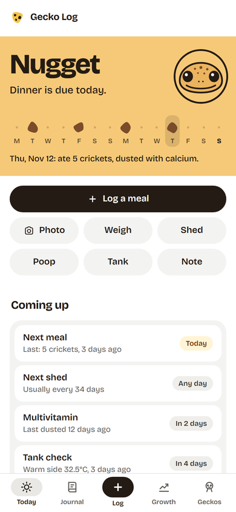
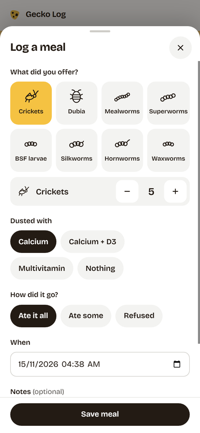
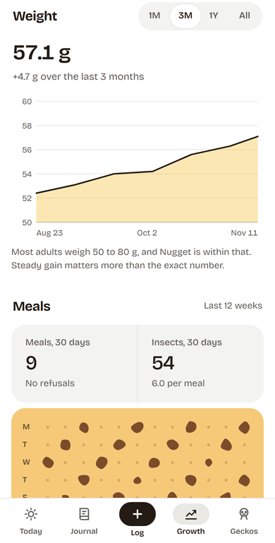

# Gecko Log

A phone app for looking after a leopard gecko: meals, supplements, weigh-ins, sheds, tank temperatures, poop checks, notes and a photo timeline. Built for Nugget, my Tremper Eclipse leopard gecko.

Live at **[arifaqyl.me/gecko](https://arifaqyl.me/gecko/)**. Open it on a phone and add it to the home screen. It installs like an app and works offline.

<p>
  
  
  
</p>

## What it does

- **Today** answers one question: does she need anything from me today? The top band is drawn in the gecko's own skin colours, and every spot on it is a meal. Tap a spot to see what she ate that day; refused meals are hollow rings.
- **Logging** takes a couple of taps: meals (insect, count, dusting, ate all, some or refused), weigh-ins with a tail check, sheds (including stuck shed on toes), poop, tank readings and notes.
- **Supplements** are suggested for you: when calcium + D3 or the multivitamin is due, the meal form picks it.
- **Warnings** for stuck shed, three refused meals in a row, weight loss over 10% and unusual poop.
- **Growth**: a weight chart, a 12-week meal calendar, favourite feeders, shed history and a photo timeline with age and weight on every picture.
- **Several geckos**, each in its morph's colours (classic, tangerine, albino, snow, blizzard, and so on).
- **Care guide** with feeding, supplement, temperature and shed basics, plus when to see a vet.

## How it works

- `gecko-tracker/index.html` is the whole app: one HTML file, vanilla JavaScript, no framework and no build step.
- The log lives on the phone (`localStorage`, photos in `IndexedDB`). There is no account.
- `gecko-tracker/sw.js` caches the app for offline use and shows reminder notifications.
- `gecko-tracker/server/gecko_sync.py` is an optional backup and reminder service. It is about 340 lines of standard-library Python plus `cryptography` and `requests`, running on a Raspberry Pi behind nginx:
  - **Backup**: the app makes a random secret code, and the log and photos sync to the Pi under that code. A link with the code opens the same log on another device. 30 daily copies are kept.
  - **Reminders**: once a day, at the time you choose, the Pi works out what is due from the saved log and sends a Web Push notification. The VAPID signing and `aes128gcm` payload encryption (RFC 8291 and RFC 8292) are written by hand.

## Run it yourself

```bash
# the app: any static file server works
python -m http.server 8000 --directory gecko-tracker

# the optional sync and reminder service
pip install cryptography requests
GECKO_PORT=8096 python gecko-tracker/server/gecko_sync.py
```

Serve `gecko-tracker/` at `/gecko/` and proxy `/gecko-api/` to the service. Reminders need HTTPS. On iPhone they only work once the app is on the home screen.

## Design

Designed with four design skills used together (tasteskill, Anthropic's frontend-design, ui-ux-pro-max and Vercel's Web Interface Guidelines). The one bold idea is the gecko's skin: meals become leopard spots. Everything else stays quiet. Bricolage Grotesque is the only typeface. The feeder insects, tails and gecko are drawn in SVG, with no emoji.

## A note on the care advice

The guidance in the app comes from common care sheets, which don't always agree. It is a starting point, not veterinary advice. A reptile vet knows your gecko best.

## Licence

MIT
